**Mini-Project 2 (CPE333 Operating Systems)** 

CPU Virtualization 

**Group Members**

| No. | Name | Student ID | Role |
| :---: | :---: | :---: | :---: |
| 1 | นายจิรภัทร เจริญพิพัฒธาดา | 67070507217 | |
| 2 | นางสาวธนภรณ์ บุณฑริกมาศ | 67070507204 | |
| 3 | นายศักย์ศรณ์ บูรณะธนานันท์ | 67070507208 | |
| 4 | นายภูรินท์ มีบทสม | 67070507214 | |
| 5 | นางสาวทรรศน์วรรณ นามกา | 67070507202 | |
| 6 | นางสาวจารุวรรณ อินตา | 67070507216 | |
| 7 | นายธีรวัฒญ์ รุ่งสว่าง | 67070507206 | |
| 8 | นายอภิวัชร์ ปัณฐธนาพัฒน์ | 67070507209 | |

### **บทนำ**

**1.ที่มาและความสำคัญ** 

ในระบบปฏิบัติการสมัยใหม่ การบริหารจัดการ CPU ถือเป็นหัวใจสำคัญที่ส่งผลโดยตรงต่อประสิทธิภาพและการตอบสนองของระบบ ระบบปฏิบัติการ Linux มี CPU Virtualization ผ่านตัวจัดตารางเวลาโพรเซส (Process Scheduler) ที่ทำหน้าที่จัดสรรเวลาการทำงานของ CPU ให้แก่โพรเซสต่าง ๆ รวมถึงการย้ายโพรเซสข้ามคอร์ (Process Migration) เพื่อกระจายภาระงานให้เหมาะสม อย่างไรก็ตาม การทำความเข้าใจพฤติกรรมที่แท้จริงของตัวจัดตารางเวลาในระดับระบบปฏิบัติการนั้นจำเป็นต้องอาศัยการสังเกตการณ์ในระดับ Kernel

โครงงานนี้จึงจัดทำขึ้นเพื่อศึกษาและสังเกตการณ์กลไกการจัดตารางเวลาและการย้ายโพรเซสของระบบปฏิบัติการ Linux ในทางปฏิบัติ โดยใช้วิธีการแก้ไขและคอมไพล์ไฟล์ระดับเคอร์เนล (Re-build kernel files) ร่วมกับการศึกษาใช้งานกลไกการติดตามเหตุการณ์ของเคอร์เนล (Kernel Tracepoints) ได้แก่ sched\_wakeup, sched\_switch และ sched\_migrate\_task เพื่อพัฒนาเครื่องมือวิเคราะห์การทำงานของตัวจัดตารางเวลา (Process Scheduler Profiler) ที่สามารถติดตามและสรุปสถิติพฤติกรรมการทำงานของโพรเซสเป้าหมายได้อย่างเป็นรูปธรรม

**2 .วัตถุประสงค์ของโครงงาน**

* เพื่อศึกษากลไกการทำงานของ Process Scheduler การย้ายโพรเซสระหว่างคอร์ รวมถึงโครงสร้างของ Tracepoints ในระบบปฏิบัติการ Linux  
* เพื่อออกแบบและพัฒนาเครื่องมือ Process Scheduler Profiler ในระดับเคอร์เนลที่สามารถรับค่า process\_id เป้าหมายผ่าน /proc หรือ Command Line Arguments ได้  
* เพื่อติดตามและบันทึกสถิติกิจกรรมการจัดตารางเวลาของโพรเซสที่กำหนด ได้แก่ จำนวนครั้งที่โพรเซสถูกจัดให้เข้าทำงาน (Scheduled in) และหยุดทำงาน (Scheduled out) จำนวนครั้งที่โพรเซสถูกปลุกให้ทำงาน (Woken up) และจำนวนครั้งที่โพรเซสถูกย้ายข้ามระหว่างคอร์ของ CPU

**3\. ขอบเขตของโครงงาน**

* ศึกษาและเปรียบเทียบเครื่องมือและรูปแบบการติดตามการทำงานในระดับเคอร์เนล เช่น ftrace, perf รวมถึงรูปแบบการประกาศ Tracepoint อย่าง DECLARE\_TRACE และ TRACE\_EVENT  
* ดำเนินการแก้ไขและคอมไพล์ไฟล์เคอร์เนลใหม่ (Re-build kernel files) เพื่อให้บรรลุเป้าหมายในการติดตามการทำงานของโพรเซสตามที่กำหนด  
* พัฒนาฟังก์ชันการรับอินพุตเป็นหมายเลข process\_id ของโพรเซสที่ต้องการตรวจสอบ และแสดงผลค่าสถิติการเปลี่ยนสถานะและการย้ายคอร์ของโพรเซสออกมาได้อย่างครบถ้วน

**4\. ประโยชน์ที่คาดว่าจะได้รับ**

* เข้าใจหลักการและขั้นตอนการทำงานจริงของระบบจัดตารางเวลาโพรเซสในระดับ Linux Kernel ได้อย่างลึกซึ้ง  
* มีทักษะในการแก้ไข ปรับแต่ง และคอมไพล์ไฟล์ระดับเคอร์เนล รวมถึงการใช้งานระบบ Tracepoints เพื่อตรวจสอบการทำงานภายในของระบบปฏิบัติการ  
* ได้เครื่องมือ Process Scheduler Profiler ที่สามารถนำไปใช้สังเกตการณ์และวิเคราะห์พฤติกรรมการทำงานของโพรเซสบนระบบปฏิบัติการ Linux ได้จริง

บทนำ ทฤษฎีและความรู้พื้นฐาน  
            (CPU virtualization, process scheduling,  
             context switch, wakeup, migration,  
             tracepoint / ftrace / perf)   
**หลักการและทฤษฎี** 

### **CPU Virtualization**

### **1\. นิยามและแนวคิดพื้นฐานของ CPU Virtualization**

    CPU Virtualization คือ เทคนิคการสร้างภาพทางนามธรรม (Abstraction) และการจัดตารางเวลาของทรัพยากรหน่วยประมวลผลทางกายภาพ (Physical Processor) เพื่อให้ระบบคอมพิวเตอร์เสมือนหรือ Virtual Machines (VMs) หลายระบบสามารถใช้งานหน่วยประมวลผลร่วมกันเสมือนเป็นหน่วยประมวลผลอิสระ โดยระบบปฏิบัติการเกสต์ (Guest OS) แต่ละตัวจะมองเห็นว่าตนเองมีหน่วยประมวลผลเฉพาะตัวและครอบครองเครื่องคอมพิวเตอร์ทั้งหมดอย่างเป็นเอกเทศ ทั้งที่ในความเป็นจริงกำลังแบ่งปันขีดความสามารถของ CPU ทางกายภาพร่วมกับระบบอื่นบนเครื่องแม่ข่าย (Host)

    จุดมุ่งหมายหลักของ CPU Virtualization คือการเน้นประสิทธิภาพการประมวลผลสูงสุด โดยคำสั่งส่วนใหญ่ของระบบเกสต์จะถูกส่งไปประมวลผลบนฮาร์ดแวร์จริงโดยตรง (Direct Execution) เมื่อมีความปลอดภัยและเป็นไปได้ ส่วนเลเยอร์การจำลองเสมือน (Virtualization Layer) จะเข้ามาแทรกแซงและจัดการเฉพาะคำสั่งที่จำเป็นต่อการควบคุมความมั่นคงและการแบ่งแยกทรัพยากรเท่านั้น 

### **2\. โครงสร้างและองค์ประกอบหลัก (Core Components & Roles)**

ในการจำลอง CPU เสมือน มีองค์ประกอบและบทบาทสำคัญที่ทำงานสอดประสานกันดังนี้ :

* **Physical CPU Resources:** ทรัพยากรฮาร์ดแวร์จริงของเครื่องแม่ข่าย ซึ่งประกอบด้วย:  
  * **CPU Socket:** ช่องเชื่อมต่อบนเมนบอร์ดสำหรับติดตั้งแพ็กเกจของโพรเซสเซอร์  
  * **Processor Core:** หน่วยประมวลผลจริงทางกายภาพภายในชิป CPU  
  * **Logical Processor:** บริบทการประมวลผลทางฮาร์ดแวร์ที่ระบบจัดตารางเวลาใช้งานได้ เช่น เทคโนโลยี Hardware Multithreading / Hyper-Threading ที่ทำให้มีจำนวน Logical CPU มากกว่า Physical Core  
* **Hypervisor / Virtual Machine Monitor (VMM):** เลเยอร์ซอฟต์แวร์หรือเฟิร์มแวร์ที่เป็นหัวใจสำคัญในการสร้าง บริหารจัดการ และควบคุมการเข้าถึงฮาร์ดแวร์ของแต่ละ VM แบ่งออกเป็น 2 ประเภท :  
  * **Type 1 Hypervisor (Bare-metal):** ติดตั้งและรันบนฮาร์ดแวร์โดยตรงโดยไม่ต้องมี Host OS ขั้นกลาง ให้ประสิทธิภาพและความมั่นคงปลอดภัยสูง เช่น VMware ESXi, KVM  
  * **Type 2 Hypervisor (Hosted):** ทำงานอยู่บนระบบปฏิบัติการหลัก (Host OS) เหมาะสำหรับการพัฒนาและการทดสอบ เช่น VirtualBox, VMware Workstation  
* **Virtual CPU (vCPU):** หน่วยประมวลผลเสมือนที่จัดสรรให้กับ VM โดย vCPU ไม่ได้ผูกขาดกับคอร์ทางกายภาพอย่างถาวร แต่เป็นทรัพยากรเสมือนที่ Hypervisor จะหยิบไปจัดสรรเวลาประมวลผลลงบน Physical หรือ Logical Processor ที่พร้อมใช้งาน ตัวอย่างเช่น การกำหนดให้ VM มี 4 vCPUs ไม่ได้หมายความว่า VM นั้นจะยึดครอง 4 Physical Cores ไว้ตลอดเวลา  
* **Guest Operating System:** ระบบปฏิบัติการที่ติดตั้งและทำงานอยู่ภายใน VM (เช่น Linux หรือ Windows) ซึ่งจะมองเห็น vCPU เป็นซีพียูจริง และทำหน้าที่จัดตารางเวลาให้กับโพรเซสและเธรดภายในระบบของตนเองต่อไป

**3\. กลไกและรูปแบบของ CPU Virtualization (Virtualization Techniques)** 

####      **3.1 Full Virtualization ผ่าน Binary Translation**

Guest OS สามารถนำมารันได้ทันทีโดยไม่ต้องแก้ไขซอร์สโค้ดหรือคอมไพล์เคอร์เนลใหม่ โดย Hypervisor จะใช้การแปลคำสั่งเชิงรหัสสองสถานะ (Binary Translation) เพื่อดักจับและเปลี่ยนคำสั่งระบบที่ไม่ปลอดภัยให้กลายเป็นชุดคำสั่งที่ปลอดภัยก่อนส่งให้ฮาร์ดแวร์จริง แม้จะมีความเข้ากันได้สูงแต่มี Overhead จากกระบวนการแปลคำสั่งด้วยซอฟต์แวร์

####      **3.2 Paravirtualization**

ลดทอนปัญหา Overhead ด้วยการปรับปรุงเคอร์เนลของ Guest OS ให้รับรู้ว่าตนเองกำลังทำงานอยู่ในระบบเสมือนคำสั่งที่ต้องควบคุมระบบจะถูกเปลี่ยนเป็นการเรียกฟังก์ชันพิเศษตรงไปยัง Hypervisor ที่เรียกว่า Hypercalls (คล้ายคลึงกับ System Calls ในระดับ OS) ทำให้มีประสิทธิภาพและความรวดเร็วสูงขึ้น แต่มีข้อจำกัดที่ต้องใช้ระบบปฏิบัติการที่รองรับการปรับแต่งเคอร์เนล

####      **3.3 Hardware-Assisted CPU Virtualization**

โปรเซสเซอร์ยุคใหม่มีส่วนขยายทางฮาร์ดแวร์มาในตัว เช่น Intel VT-x และ AMD-V (พร้อมชุดคำสั่ง Virtual Machine Extension: VMX) ฮาร์ดแวร์จะเพิ่มระดับการทำงานใหม่ (เช่น Root Mode สำหรับ Hypervisor และ Non-Root Mode สำหรับ Guest OS) ช่วยให้การส่งคำสั่งของเกสต์ไปรันบน CPU ทำได้โดยตรง และโอนย้ายการสลับบริบท (Context Switching) ไปให้ฮาร์ดแวร์จัดการ ทำให้ลดการแทรกแซงของ Hypervisor และทำงานได้เร็วใกล้เคียงเครื่องจริง

### **4\. กลไกการจัดตารางเวลาและการแบ่งปันทรัพยากร (CPU Scheduling & Resource Allocation)**

เนื่องจากทรัพยากร CPU ทางกายภาพมีจำกัด การจัดสรรเวลาให้ vCPU จำนวนมากทำงานพร้อมกันจึงอาศัยกลไกหลักดังนี้ :

#### **4.1 การแบ่งส่วนเวลา (Time Slicing) และ Overcommitment**

เมื่อผลรวมความต้องการของ vCPU มีมากกว่าความสามารถทางกายภาพของเครื่องโฮสต์ (Overcommitment) Hypervisor จะใช้เทคนิค Time Slicing คือการแบ่งหน้าต่างเวลาในการประมวลผลออกเป็นช่วงสั้นๆ และสลับให้ vCPU ของแต่ละ VM ผลัดกันเข้าใช้งาน ทำให้ผู้ใช้งานรู้สึกเสมือนว่าทุก VM กำลังประมวลผลไปพร้อมๆ กัน

#### **4.2 การแย่งชิงทรัพยากร (CPU Contention)**

CPU Contention เกิดขึ้นเมื่อมีเวิร์กโหลดในสถานะพร้อมรัน (Runnable Workloads) แย่งชิงเวลาของ Physical CPU ที่มีไม่เพียงพอ สาเหตุทั่วไปเกิดจาก :

* มี VM ที่มีภาระงานสูงทำงานพร้อมกันเป็นจำนวนมาก  
* การจัดสรร vCPU เกินความจำเป็น (Oversized vCPU Allocations) ซึ่งสร้างภาระการจัดตารางเวลาให้กับระบบโดยไม่ก่อให้เกิดประโยชน์  
* ผลกระทบของ Contention ส่งผลให้เกิดความล่าช้าในการจัดคิว (Scheduling Wait / Ready Time สูงขึ้น) และประสิทธิภาพโดยรวมของแอปพลิเคชันลดลง

### 

### 

### 

### **5\. ประโยชน์และความท้าทายของ CPU Virtualization**

#### **ประโยชน์หลัก (Benefits)**

1. Server Consolidation: รวมศูนย์เซิร์ฟเวอร์กายภาพหลายเครื่องเข้ามาอยู่บนโฮสต์ประสิทธิภาพสูงเครื่องเดียว ช่วยประหยัดค่าใช้จ่ายด้านฮาร์ดแวร์ พลังงาน และการระบายความร้อนได้ 50–70%  
2. Resource Utilization: ดึงขีดความสามารถของ CPU ที่มักว่างเปล่าในระบบดั้งเดิมมาใช้ประโยชน์ได้อย่างเต็มที่  
3. Workload Isolation & Security: แต่ละ VM แยกขาดจากกันอย่างสมบูรณ์ หากระบบปฏิบัติการเกสต์ตัวหนึ่งมีช่องโหว่หรือล่ม จะไม่ส่งผลกระทบข้ามไปยัง VM อื่นๆ บนโฮสต์เดียวกัน  
4. Scalability & Flexibility: สามารถปรับขนาด ปรับเปลี่ยนจำนวน vCPU หรือโยกย้าย VM ได้อย่างยืดหยุ่นตามความต้องการของแอปพลิเคชัน

#### **ความท้าทายและข้อจำกัด (Challenges)**

1. Virtualization Overhead: เลเยอร์จำลองเสมือนยังคงใช้ทรัพยากรส่วนหนึ่งในการควบคุมและจัดการการสลับสถานะ  
2. Performance Variability: การแบ่งปันทรัพยากรร่วมกันอาจทำให้ความเร็วแปรผันตามพฤติกรรมของ VM ข้างเคียง  
3. Security Risks (VM Escape): ความเสี่ยงจากช่องโหว่ที่ผู้ไม่หวังดีอาจเจาะทะลุระบบแยกส่วนเพื่อเข้าควบคุมเครื่องโฮสต์ได้

### **6\. ความเชื่อมโยงสู่ระดับระบบปฏิบัติการ (Bridging to OS Process Scheduling)**

หลักการของ CPU Virtualization ในระดับฮาร์ดแวร์และไฮเปอร์ไวเซอร์ (การจัดตารางเวลาให้ vCPU เข้าครอบครอง Physical CPU) มีความคล้ายคลึงอย่างลึกซึ้งกับ CPU Virtualization ในระดับระบบปฏิบัติการ (OS-level CPU Virtualization):

* ภายในเคอร์เนลของระบบปฏิบัติการ (เช่น Linux Kernel) มีการทำ Virtualization ให้กับแต่ละ โพรเซส (Process) เพื่อสร้างภาพลวงตาว่าโพรเซสนั้นเป็นเจ้าของ CPU แต่เพียงผู้เดียว  
* ผู้ทำหน้าที่จัดสรรเวลาไม่ใช่ Hypervisor แต่เป็น Process Scheduler ของเคอร์เนล  
* พฤติกรรมของการสลับเวลา (Context Switch: Schedule-in / Schedule-out), การปลุกโพรเซส (Wakeup), และการย้ายงานข้ามคอร์ (Migration) ในระดับเคอร์เนล จึงเป็นกลไกจำลองหน่วยประมวลผลเสมือนพื้นฐานที่ต้องใช้เครื่องมือตรวจสอบระดับลึก เช่น Tracepoints, ftrace และ perf ในการวัดผลและวิเคราะห์พฤติกรรมจริง

## **Process Scheduling & State Transitions**

### **1\. บทบาทและหน้าที่ของ Process Scheduler ในระบบปฏิบัติการ**

ในระบบปฏิบัติการสมัยใหม่ที่รองรับการทำงานหลายโปรแกรมพร้อมกัน (Multiprogramming / Multitasking) **Process Scheduler** เป็นองค์ประกอบหลักของเคอร์เนลที่ทำหน้าที่จัดการและตัดสินใจว่าโพรเซสหรือเธรดใดในระบบจะได้รับสิทธิ์เข้าครอบครองและประมวลผลบนแกนประมวลผล (CPU Core) รวมถึงกำหนดว่าจะได้ทำงานเป็นระยะเวลานานเท่าใด

หน้าที่หลักของ Process Scheduler :

* **Arbitration & Fairness:** จัดสรรเวลาของ CPU ให้กับโพรเซสต่างๆ ที่พร้อมทำงานอย่างเป็นธรรม ป้องกันปัญหาโพรเซสอดอยาก (Starvation)  
* **Throughput & Utilization:** รักษาอัตราการใช้ประโยชน์จาก CPU (CPU Utilization) ให้มีประสิทธิภาพสูงสุดตลอดเวลา โดยไม่ปล่อยให้แกนประมวลผลว่างเปล่าหากยังมีงานค้างอยู่ในคิว  
* **Latency & Responsiveness:** ตอบสนองต่อเหตุการณ์ภายนอก (เช่น สัญญาณขัดจังหวะจากอุปกรณ์ I/O หรือการโต้ตอบของผู้ใช้) ได้อย่างทันท่วงที

ระบบจัดตารางเวลาจะแบ่งแยกบทบาทร่วมกับ **Dispatcher** โดยตัว Scheduler ทำหน้าที่คัดเลือกโพรเซสถัดไปจาก Ready Queue ขณะที่ Dispatcher เป็นกลไกที่นำโพรเซสนั้นไปติดตั้งลงบน CPU จริงผ่านกระบวนการ Context Switch

### **2.Process States & Transitions**

วงจรชีวิตของโพรเซสตั้งแต่ถูกสร้างขึ้นจนกระทั่งทำงานเสร็จสิ้นจะถูกควบคุมผ่านการเปลี่ยนสถานะ (Process State Transitions) โดยมีสถานะหลัก 5 ประการ :

![][image1]

1. **New:** สถานะเริ่มต้นเมื่อโพรเซสถูกสร้างขึ้น (เช่น การเรียกฟังก์ชันระบบ fork() หรือ clone()) และกำลังรอให้ระบบจัดสรรโครงสร้างข้อมูล  
2. **Ready:** โพรเซสโหลดเข้าสู่หน่วยความจำหลักและมีทรัพยากรทุกอย่างพร้อมประมวลผลแล้ว ขาดเพียงสิทธิ์ในการครอบครอง CPU โดยจะถูกจัดเก็บไว้ในคิวพร้อมรัน (Runqueue)  
3. **Running:** คำสั่งของโพรเซสกำลังถูกประมวลผลอยู่บนคอร์ของ CPU จริง  
4. **Waiting (Blocked):** โพรเซสหยุดการทำงานชั่วคราวเพื่อรอเหตุการณ์ภายนอก เช่น การรออ่านข้อมูลจากดิสก์/เครือข่าย (I/O Completion), การรอสัญญาณ (Signal), หรือการรอปลดล็อก Mutex  
5. **Terminated:** โพรเซสประมวลผลคำสั่งเสร็จสิ้นและคืนทรัพยากรให้แก่ระบบ

### **Context Switch: Schedule-in & Schedule-out)**

การสลับบริบท (Context Switch) คือหัวใจของการสร้างภาพลวงตาของ CPU Virtualization ในระดับระบบปฏิบัติการ ซึ่งเปิดโอกาสให้โพรเซสหลายตัวผลัดกันใช้ CPU อย่างต่อเนื่อง

#### **3.1 องค์ประกอบของ Process Context**

ข้อมูลบริบทของโพรเซสจะถูกบันทึกไว้ในโครงสร้างข้อมูลระดับเคอร์เนลที่เรียกว่า **Process Control Block (PCB)** หรือในเคอร์เนล Linux คือ struct task\_struct ซึ่งประกอบด้วย:

* **Hardware Registers:** ค่าในรีจิสเตอร์สถาปัตยกรรม เช่น แอกคิวมูเลเตอร์, รีจิสเตอร์ทั่วไป  
* **Program Counter (PC / Instruction Pointer):** ตำแหน่งของคำสั่งถัดไปที่จะประมวลผล  
* **Stack Pointer (SP):** ตำแหน่งชี้ส่วนบนสุดของ Call Stack (ทั้ง User Stack และ Kernel Stack)  
* **Memory Management Information:** แอดเดรสของ Page Table และแผนผังพื้นที่หน่วยความจำเสมือน (struct mm\_struct)

#### **3.2 ขั้นตอนการทำงาน: Schedule-out และ Schedule-in**

เมื่อเกิดเงื่อนไขที่ต้องเปลี่ยนผู้ใช้งาน CPU เช่น หมดช่วงเวลาจัดสรร (Time-slice Expired), เกิดการชิงสิทธิ์ (Preemption) จากโพรเซสที่มีความสำคัญสูงกว่า , หรือโพรเซสเดิมเรียก System Call เพื่อรอ I/O:

* **Schedule-out:** เคอร์เนลจะหยุดการทำงานของโพรเซสเดิม ดึงค่าสถานะของฮาร์ดแวร์รีจิสเตอร์ทั้งหมด ณ ปัจจุบันมาบันทึกเก็บไว้ใน PCB/Task Struct ของโพรเซสนั้น แล้วถอดโพรเซสออกจากสถานะ Running นำไปจัดเก็บในสถานะ Ready หรือ Waiting  
* **Schedule-in:** เคอร์เนลจะเลือกโพรเซสตัวใหม่จาก Runqueue จากนั้นโหลดบริบทที่เคยบันทึกไว้ใน PCB ของโพรเซสใหม่กลับคืนสู่รีจิสเตอร์ของ CPU และสลับพื้นที่แอดเดรสหน่วยความจำ (Address Space Switch) เพื่อให้โพรเซสใหม่เริ่มทำงานต่อเนื่องจากจุดเดิมได้ทันที

#### **3.3 ต้นทุนความสูญเสีย (Context Switching Overhead)**

การทำ Context Switch เป็นกระบวนการที่สูญเสียพลังการประมวลผลโดยตรง (**Direct Overhead**) เนื่องจากในขณะที่เคอร์เนลกำลังสลับสถานะ CPU จะไม่ได้ทำงานที่เป็นเนื้อแท้ของโปรแกรมผู้ใช้ นอกจากนี้ยังก่อให้เกิดผลกระทบทางอ้อม (**Indirect Overhead**) จากการสูญเสียข้อมูลแคช (Cache Invalidation) และการล้างข้อมูลใน Translation Lookaside Buffer (TLB) ส่งผลให้การเข้าถึงหน่วยความจำในช่วงแรกของโพรเซสใหม่ช้าลง

### **4\. กลไกการปลุกโพรเซส (Process Wakeup)**

**Process Wakeup** คือกระบวนการที่เคอร์เนลปรับเปลี่ยนสถานะของโพรเซสจาก **Waiting (Blocked)** กลับมาเป็น **Ready** เพื่อเตรียมตัวเข้าคิวรอจัดสรรเวลาของ CPU อีกครั้ง

#### **4.1 ลำดับขั้นการเกิด Wakeup**

1. **การเกิดเหตุการณ์ (Event Arrival):** อุปกรณ์ฮาร์ดแวร์สร้างสัญญาณขัดจังหวะ (Interrupt) แจ้งว่าข้อมูล I/O พร้อมแล้ว หรือมีโพรเซสอื่นส่งสัญญาณ IPC / ปลดล็อก Synchronization Primitive  
2. **Interrupt Service Routine (ISR) & Bottom Half:** ตัวจัดการอินเทอร์รัปต์ของเคอร์เนลจะตรวจสอบว่ามีโพรเซสใดกำลังนอนหลับ (Sleeping) อยู่บน Wait Queue ของเหตุการณ์นั้น  
3. **การเปลี่ยนสถานะและการย้ายคิว:** เคอร์เนลจะเปลี่ยนสถานะโพรเซสจาก TASK\_INTERRUPTIBLE หรือ TASK\_UNINTERRUPTIBLEให้กลายเป็น TASK\_RUNNING  (สถานะพร้อมรัน) พร้อมนำ Task ดังกล่าวเข้าสู่ **Runqueue** ของ CPU  
4. **Preemption Check:** หากโพรเซสที่เพิ่งตื่นมีลำดับความสำคัญ (Priority) หรือค่าความเร่งด่วนสูงกว่าโพรเซสที่กำลังทำงานอยู่บนคอร์ ณ ปัจจุบัน ตัวจัดตารางเวลาอาจตั้งค่าสถานะขอสลับการทำงานทันที (Preemption) เพื่อให้โพรเซสที่ตื่นขึ้นมารับช่วงประมวลผลได้รวดเร็วที่สุด

### **5\. การย้ายโพรเซสข้ามแกนประมวลผล (CPU Migration)**

ในระบบสถาปัตยกรรมหลายแกนประมวลผล (Multi-core) และระบบหลายซ็อกเก็ต (SMP / NUMA) ทรัพยากร CPU ทางกายภาพจะถูกแบ่งออกเป็นหลายคอร์ โดยระบบปฏิบัติการ Linux จะแยกคิวพร้อมรัน (Runqueue) ประจำแต่ละคอร์เพื่อลดปัญหา Lock Contention

**5.1 ความจำเป็นของการย้ายโพรเซส**

ในระหว่างการทำงานจริง ภาระงานของแต่ละคอร์มักไม่เท่ากัน คอร์หนึ่งอาจมีโพรเซสรันอยู่หนาแน่น ขณะที่อีกคอร์หนึ่งว่างงาน เคอร์เนลจึงต้องมีกลไก **Load Balancing** เข้ามาตรวจสอบและดึงโพรเซสข้ามคอร์:

* **Active Load Balancing:** ตัวตรวจวัดระดับเคอร์เนลพบว่าความไม่สมดุลของงานเกินเกณฑ์ที่กำหนด จึงสั่งย้ายโพรเซสไปยังคอร์อื่น  
* **Idle Balancing:** เมื่อคอร์ใดคอร์หนึ่งทำงานในคิวหมดและกำลังจะเข้าสู่โหมดว่าง (Idle) คอร์นั้นจะพยายามดึงงาน (Pull migration) จาก Runqueue ของคอร์ข้างเคียงมาประมวลผล

#### **5.2 ผลกระทบของ CPU Migration**

* **ผลดี:** กระจายการประมวลผลได้เต็มกำลัง ลดเวลาการรอคอยในคิว และยกระดับ Throughput รวมของระบบ  
* **ผลเสีย (Cache Locality Loss):** เมื่อโพรเซสถูกย้ายไปรันบนคอร์ใหม่ ข้อมูลของโพรเซสที่เคยอยู่ใน L1/L2 Cache ของคอร์เดิมจะไม่สามารถเข้าถึงได้ ส่งผลให้อัตรา Cache Miss พุ่งสูงขึ้น และหากเป็นการย้ายข้ามโหนด NUMA การเข้าถึงหน่วยความจำระยะไกล (Remote Memory Access) จะก่อให้เกิดความหน่วง (Memory Latency) เพิ่มขึ้นอย่างมีนัยสำคัญ

## **Kernel Tracing Infrastructure**

### **1\. โครงสร้างพื้นฐานของ Kernel Tracepoints**

**Tracepoint** คือกลไกการแทรกโค้ดตรวจวัดแบบคงที่ (**Static Instrumentation**) ที่ถูกฝังไว้ตามจุดสำคัญต่าง ๆ ภายในซอร์สโค้ดของ Linux Kernel มีวัตถุประสงค์เพื่อให้ระบบสามารถติดตามและดักฟังพฤติกรรมการทำงานภายในเคอร์เนลได้โดยตรง:

* **Zero-overhead เมื่อไม่ใช้งาน:** ในขณะที่ Tracepoint ปิดใช้งาน (Disabled) จุดตรวจสอบจะมี Overhead ต่ำมาก โดยเคอร์เนลใช้เทคนิคแปลงคำสั่งเป็น NOP (No-Operation) ทำให้ไม่มีผลกระทบต่อประสิทธิภาพการทำงานปกติของระบบ  
* **Callback Execution เมื่อเปิดใช้งาน:** เมื่อมีเครื่องมือหรือโมดูลภายนอกเข้าไปเชื่อมต่อ (Hook) คำสั่งจะถูกแทนที่เพื่อให้กระโดดไปประมวลผลฟังก์ชัน Callback (Probe Function) ที่ลงทะเบียนไว้ พร้อมส่งพารามิเตอร์ของเหตุการณ์นั้น ๆ ไปบันทึกข้อมูล  
* **จุดตรวจสอบการจัดตารางเวลาของ CPU:** ในโจทย์โครงงาน Process Scheduler Profiler เคอร์เนลมี Tracepoint สำคัญที่เกี่ยวข้องโดยตรง ได้แก่:  
  1. sched\_wakeup : ดักจับเมื่อโพรเซสถูกปลุกเข้าสู่ Ready Queue  
  2. sched\_switch : ดักจับเหตุการณ์การสลับบริบท (Schedule-in และ Schedule-out)  
  3. sched\_migrate\_task : ดักจับเมื่อโพรเซสถูกย้ายข้ามแกนประมวลผล (CPU Migration)

### **2\. การสร้างและกำหนด Tracepoint: DECLARE\_TRACE vs TRACE\_EVENT**

ในการเชื่อมโยงและสร้าง Tracepoint ระดับเคอร์เนล มี 2 มาโครหลักที่ทำงานร่วมกันในรูปแบบลำดับชั้น

* **DECLARE\_TRACE (Low-level Macro):** เป็นมาโครระดับต่ำที่ใช้ประกาศจุดเชื่อมต่อพื้นฐานและสร้างฟังก์ชันสำหรับลงทะเบียน Callback (register\_trace\_\*) โดยผู้พัฒนาต้องเขียนฟังก์ชัน Probe จัดการโครงสร้างข้อมูล และส่งผ่านข้อมูลไปยัง User-space ด้วยตนเอง  
* **TRACE\_EVENT (High-level Abstraction):** เป็นมาโครระดับสูงที่สร้างขึ้นครอบ DECLARE\_TRACE โดยรวมการกำหนดโครงสร้างข้อมูล (TP\_STRUCT\_\_entry), การคัดลอกฟิลด์ข้อมูล (TP\_fast\_assign), และรูปแบบการแสดงผล (TP\_printk) ไว้ในจุดเดียว ช่วยให้ Tracepoint นั้นเชื่อมต่อเข้ากับระบบ Tracing ของเคอร์เนล เช่น ftrace และ perf ได้ทันทีโดยไม่ต้องเขียนโค้ดสนับสนุนเพิ่มเติม

### **3\. เครื่องมือวิเคราะห์ประสิทธิภาพ: ftrace และ perf**

ระบบปฏิบัติการ Linux มีเครื่องมือวิเคราะห์ระดับเคอร์เนลสองตัวหลักที่นำ Tracepoint มาใช้งาน :

#### **3.1 ftrace (Function Tracer)**

* **ลักษณะการทำงาน:** เป็นตัวติดตามหลัก (Official Tracer) ที่ฝังตัวอยู่ภายในเคอร์เนล มีอินเทอร์เฟซควบคุมผ่าน Virtual Filesystem ที่ไดเรกทอรี /sys/kernel/debug/tracing/ หรือ /sys/kernel/tracing/  
* **บทบาทด้าน Scheduler:** สามารถสั่งเปิด-ปิด Tracepoint ของระบบจัดตารางเวลาผ่านไฟล์ events/sched/\*/enable และอ่านบันทึกไทม์ไลน์ของเหตุการณ์ต่าง ๆ แบบ Real-time ผ่านไฟล์ trace หรือ trace\_pipe  
* **จุดเด่น:** ติดตั้งมาพร้อมกับเคอร์เนล มี Overhead ต่ำ และเหมาะสำหรับการตรวจสอบลำดับเหตุการณ์ (Event Sequence) อย่างละเอียด

#### **3.2 perf (Performance Counters for Linux)**

* **ลักษณะการทำงาน:** เครื่องมือวิเคราะห์ประสิทธิภาพผ่านยูทิลิตีบรรทัดคำสั่ง (CLI) ใน Userspace ที่เชื่อมต่อกับระบบย่อย perf\_events ภายในเคอร์เนล  
* **บทบาทด้าน Scheduler:** สามารถดักจับสถิติการจัดตารางเวลาของโพรเซสแบบเจาะจง PID ได้โดยตรงผ่านคำสั่ง perf record \-e sched:\* หรือแสดงสรุปสถิติด้วย perf sched latency / map  
* **จุดเด่น:** รองรับการดึงข้อมูลทั้งจากซอฟต์แวร์อีเวนต์ (Tracepoints/Software Events) และฮาร์ดแวร์เคาน์เตอร์ (Hardware Performance Counters เช่น Cache Misses, Cycles) ทำให้เปรียบเทียบผลกระทบเชิงสถิติได้อย่างครบวงจร

### **4\. บทบาทในสถาปัตยกรรม Process Scheduler Profiler**

โครงสร้างพื้นฐานทั้งสองส่วนช่วยสนับสนุนการพัฒนาตัวตรวจวัดโพรเซสตามโจทย์ Mini-Project 2 ได้ 2 มิติ :

1. **ในระดับ Kernel Module:** สามารถอาศัยฟังก์ชัน register\_trace\_sched\_\* จากโครงสร้าง tracepoint ในการดักฟังเหตุการณ์ ณ ตำแหน่งจริงของเคอร์เนล เพื่ออัปเดตตัวแปรนับรอบ (Counters) ของ PID เป้าหมายอย่างแม่นยำ  
2. **ในระดับการตรวจสอบผล (Validation):** สามารถใช้ข้อมูลที่ได้จาก ftrace และคำสั่ง perf เป็นเกณฑ์มาตรฐาน (Ground Truth) เพื่อนำมาเปรียบเทียบความถูกต้องของจำนวนครั้งที่โพรเซสเกิด Wakeup, Context Switch และ Migration กับโมดูลที่พัฒนาขึ้น

---

## **การตรวจสอบความครบถ้วนของไฟล์ในโครงงาน (Comprehensive File Inventory & Traceability Matrix)**

เพื่อให้มั่นใจว่าผลงานของสมาชิกทุกคนในกลุ่มได้รับการบันทึก รวบรวม และอธิบายอย่างครบถ้วนโดยไม่มีส่วนใดตกหล่น ตารางต่อไปนี้สรุปไฟล์ทั้งหมดที่ถูกพัฒนาและจัดเก็บไว้ใน branch `mini2` ของ GitHub Repository (`https://github.com/jiraphat-j/linux-kernel-build-lab/tree/mini2`):

### **1. ไฟล์ซอร์สโค้ดและคอนฟิกูเรชันของ Kernel Module**

| ชื่อไฟล์ | เจ้าของ / ผู้พัฒนา | หน้าที่และรายละเอียดทางเทคนิค |
|---|---|---|
| `main.c` | คนที่ 1 (Builder 1) | โมดูลเอนทรีพอยต์ กำหนด `sp_init()` และ `sp_exit()`, จัดการล้าง procfs และ unregister probes อย่างปลอดภัย |
| `Makefile` | คนที่ 1 (Builder 1) | สคริปต์ kbuild กำหนด `obj-m += sched_profiler.o` และรวมออบเจ็กต์ไฟล์ทั้ง 5 เป็นโมดูลเดียว |
| `sched_profiler.h` | คนที่ 1 (Builder 1) | **Public Interface Header** กำหนด `struct sched_stats` และฟังก์ชันต้นแบบสำหรับภายนอก |
| `sp_internal.h` | คนที่ 2, 3 (Builders 2 & 3) | **Internal Interface Header** ประกาศตัวแปรตัวนับ `atomic_long_t` และ Prototype ของ Probe Callbacks |
| `tracepoints.c` | คนที่ 2 (Core Developer) | ศูนย์กลางการค้นหา Tracepoint แบบไดนามิกผ่าน `for_each_kernel_tracepoint()`, การควบคุม Concurrency และตัวนับ |
| `probe_switch.c` | คนที่ 2 (Builder 2) | ฟังก์ชัน Callback ดักฟังอีเวนต์ `sched_switch` เพื่อนับจำนวนครั้ง Schedule In และ Schedule Out |
| `probe_events.c` | คนที่ 3 (Builder 3) | ฟังก์ชัน Callback ดักฟัง `sched_wakeup` เพื่อนับการปลุก และ `sched_migrate_task` เพื่อนับการย้าย CPU Core |
| `procfs.c` | คนที่ 4 (Builder 4) | ส่วนต่อประสานระดับ User-space สร้าง `/proc/sched_profiler` เพื่อรับค่า PID และส่งออกสถิติ |
| `INTERFACE.md` | คนที่ 1-4 (กลุ่มโค้ดร่วมกัน) | เอกสารข้อตกลงและสัญญาทางข้อมูล (Data Contract) ก่อนเริ่มลงมือเขียนโค้ดจริง |
| `.gitignore` | คนที่ 1 (Builder 1) | กรองไฟล์ไบนารีและไฟล์ชั่วคราวจากการคอมไพล์ระดับเคอร์เนล เช่น `*.ko`, `*.mod.c`, `*.o`, `*.symvers` |

---

### **2. ไฟล์หลักฐานการทำงานและการทดสอบ (Evidence Artifacts Repository)**

| โฟลเดอร์ / ไฟล์ | เจ้าของ / ผู้ทดสอบ | วัตถุประสงค์และสิ่งที่บันทึกไว้ |
|---|---|---|
| `evidence/01-environment/` | คนที่ 1 (Setup Owner) | บันทึกสเปคของ VM VirtualBox (2-4 vCPUs), เช็กซัม SHA256 ของ Ubuntu 26.04 LTS ISO, และสภาพแวดล้อมเคอร์เนล |
| `evidence/02-skeleton/` | คนที่ 1 (Skeleton Owner) | ภาพการคอมไพล์และทดสอบโค้ดโครงร่าง (Skeleton Stub) รอบที่ 1 และ 2 ยืนยันการ insmod/rmmod เบื้องต้น |
| `evidence/03-collaboration/` | ทั้งทีม 8 คน | ภาพการสื่อสาร ประสานงาน และตกลงความคืบหน้าระหว่างสมาชิกในทีมผ่านช่องทาง Discord |
| `evidence/04-ftrace-reference/` | คนที่ 5 (Tester) | ข้อมูลล็อกอ้างอิงจาก `ftrace` มาตรฐานของ Linux บน Workload 3 รูปแบบ (CPU-bound, Pinned CPU0, Sleep loop) |
| `evidence/05-probe-switch/` | คนที่ 2 (Builder 2) | สคริปต์ `robustness_test.sh`, ผลทดสอบ manual test บน dmesg, ภาพการแก้ Warning `struct folio` |
| `evidence/06-probe-events/` | คนที่ 3 (Builder 3) | ผลการทดสอบ Wakeup และ Migration, การทดสอบบังคับย้ายคอร์ด้วย `taskset`, ภาพการตรวจสอบฟังก์ชัน Signature |
| `evidence/07-procfs/` | คนที่ 4 (Builder 4) | ภาพและล็อกการทดสอบ Edge Cases ของ `/proc/sched_profiler` เช่น ค่าว่าง, ตัวอักษร, ค่าลบ, ค่าเกิน 32 bytes |
| `evidence/08-member5/` | คนที่ 5 (Validation Owner) | สคริปต์ชุดทดสอบอัตโนมัติภาษา Python (`validate_profiler.py`, `run-validation.sh`), ผลเทียบ ftrace และ perf |

---

## **การออกแบบสถาปัตยกรรมและข้อตกลง Interface (System Architecture & Interface Design)**

### **1. เหตุผลในการเลือก `/proc` เป็นช่องทางเชื่อมต่อ**

ในการส่งผ่านข้อมูลระหว่าง User Space และ Kernel Space ทีมได้พิจารณาทางเลือกต่าง ๆ และสรุปเลือกใช้งาน Virtual Filesystem ผ่านไดเรกทอรี `/proc` ด้วยเหตุผลดังนี้:
1. **ความสะดวกในการใช้งานผ่าน Shell Scripts:** ผู้ใช้หรือโปรแกรมภายนอกสามารถสั่งงานได้โดยตรงด้วยคำสั่งพื้นฐาน เช่น `echo <pid> > /proc/sched_profiler` และอ่านผลสรุปด้วย `cat /proc/sched_profiler` โดยไม่ต้องเขียนโปรแกรมภาษา C เรียกใช้ System Call เฉพาะ
2. **ไม่กระทบต่อโครงสร้าง System Call ของเคอร์เนล:** ไม่ต้องเพิ่มเบอร์ Syscall ใหม่ ซึ่งต้องคอมไพล์เคอร์เนลทั้งระบบ
3. **การเข้ากันได้กับรูปแบบสถิติของ Linux:** ระบบปฏิบัติการ Linux ใช้ไดเรกทอรี `/proc` เป็นช่องทางหลักในการรายงานสถิติของ Process อยู่แล้ว (เช่น `/proc/<pid>/stat`, `/proc/<pid>/status`)

---

### **2. สัญญาข้อมูลและการแบ่งระดับ Interface (Interface Specification)**

ระบบถูกออกแบบโดยแบ่ง Interface ออกเป็น 2 ระดับอย่างเคร่งครัด เพื่อให้สมาชิกในทีมพัฒนาโมดูลแยกจากกันได้อย่างเป็นอิสระ:

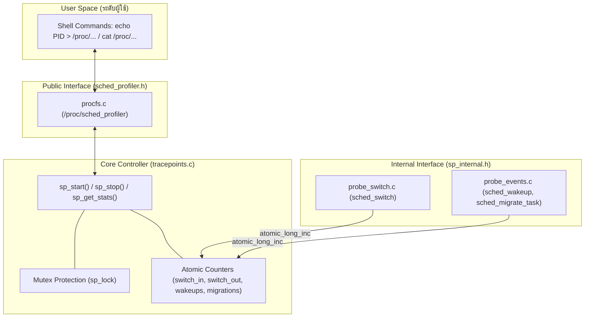

#### **2.1 Public Interface (`sched_profiler.h`)**
เป็นส่วนที่เชื่อมโยงระหว่างตัวควบคุม `/proc` (`procfs.c`) และตัวจัดการ Tracepoint (`tracepoints.c`):

```c
#ifndef SCHED_PROFILER_H
#define SCHED_PROFILER_H

#include <linux/types.h>

struct sched_stats {
	unsigned long switch_in;
	unsigned long switch_out;
	unsigned long wakeups;
	unsigned long migrations;
};

/* ฟังก์ชันควบคุมหลัก (tracepoints.c) */
int   sp_start(pid_t pid);                  /* เริ่มวัด: คืนค่า 0 หากสำเร็จ */
void  sp_stop(void);                       /* หยุดวัด: unregister probes ทั้งหมด */
int   sp_get_stats(struct sched_stats *out);/* ดึงสถิติ: 0 = สำเร็จ, -ENODATA หากยังไม่เคยรัน */
pid_t sp_target_pid(void);                 /* คืนค่า PID ที่กำลังวัด (0 = ไม่ได้วัด) */

/* ฟังก์ชันจัดการไฟล์ระบบ (procfs.c) */
int   sp_procfs_init(void);
void  sp_procfs_exit(void);

#endif /* SCHED_PROFILER_H */
```

#### **2.2 Internal Interface (`sp_internal.h`)**
เป็นส่วนที่ใช้แลกเปลี่ยนข้อมูลเฉพาะภายในกลุ่มเคอร์เนลโมดูลระหว่าง Core Controller และ Probe Handlers:

```c
#ifndef SP_INTERNAL_H
#define SP_INTERNAL_H

#include <linux/atomic.h>
#include <linux/types.h>

struct task_struct;

/* PID เป้าหมาย (อ่านด้วย READ_ONCE เพื่อความปลอดภัย) */
extern pid_t sp_target;

/* ตัวแปรนับรอบแบบ Atomic เพื่อความปลอดภัยในระบบ Multi-core */
extern atomic_long_t sp_switch_in;
extern atomic_long_t sp_switch_out;
extern atomic_long_t sp_wakeups;
extern atomic_long_t sp_migrations;

/* Probes Callbacks */
void sp_probe_sched_switch(void *data, bool preempt,
			   struct task_struct *prev,
			   struct task_struct *next,
			   unsigned int prev_state);
void sp_probe_sched_wakeup(void *data, struct task_struct *p);
void sp_probe_sched_migrate_task(void *data, struct task_struct *p, int dest_cpu);

#endif /* SP_INTERNAL_H */
```

---

### **3. กลยุทธ์การจัดการข้อผิดพลาดและรหัสคืนค่า (Error Handling Specification)**

การทำงานระดับ Kernel Module หากไม่มีการตรวจสอบอินพุตอย่างรัดกุม อาจส่งผลให้เคอร์เนลค้าง (Freeze) หรือเกิด Kernel Panic ได้ ทีมจึงได้กำหนดมาตรฐานการตรวจจับและคืนรหัสข้อผิดพลาดตามมาตรฐาน POSIX Errno ไว้อย่างชัดเจน:

| รหัสข้อผิดพลาด | ค่าตัวเลข | เงื่อนไขที่ตรวจพบ | การจัดการของโมดูล |
|---|:---:|---|---|
| `-EINVAL` | -22 | PID มีค่าน้อยกว่าหรือเท่ากับ 0, อินพุตไม่ใช่ตัวเลข, หรือมีความยาวเกิน 32 bytes | ปฏิเสธการทำงานและคืน error ไปยัง User Space ทันที |
| `-ESRCH` | -3 | ไม่พบ Process ID ดังกล่าวในระบบ (ตรวจสอบผ่าน `find_get_pid` + `pid_task`) | ปฏิเสธการเริ่มวัด ป้องกันการ hook process ผี |
| `-EBUSY` | -16 | มีคำสั่งสั่งเริ่มวัดในขณะที่ตัว Profiler กำลังทำงานติดตาม PID เดิมอยู่ | ป้องกัน Race Condition ผู้ใช้ต้องเขียน `0` เพื่อหยุดรอบเดิมก่อน |
| `-ENOENT` | -2 | ไม่พบสัญลักษณ์ Tracepoint ที่ต้องการในเคอร์เนล (เช่น เคอร์เนลไม่ได้เปิด Tracing) | แจ้งเตือนลง `dmesg` และปฏิเสธการโหลด probe |
| `-ENODATA` | -61 | ผู้ใช้สั่ง `cat /proc/sched_profiler` ทั้งที่ยังไม่เคยสั่งเริ่มวัดสักครั้ง | คืนรหัส -61 แสดงข้อความ `error: -61` บนเทอร์มินัล |

---

### **4. การควบคุม Concurrency และความปลอดภัยในหน่วยความจำ**

เนื่องจากตัววิเคราะห์ต้องทำงานบนระบบ Multi-core (SMP) ซึ่งในเสี้ยววินาทีเดียวกัน CPU คอร์หนึ่งอาจกำลังประมวลผลคำสั่งของ User ขณะที่ CPU อีกคอร์กำลังสั่ง Switch Task สถาปัตยกรรมจึงแบ่งแยกกลไกป้องกัน Concurrency ออกเป็น 2 ระดับ:

1. **Control Path (sp_start / sp_stop):** ใช้ **Mutex Lock (`sp_lock`)** เนื่องจากกระบวนการลงทะเบียน Probe และจัดสรรโครงสร้างข้อมูลอาจเกิดการ Sleep ได้ Mutex จะช่วยป้องกันไม่ให้มีคำสั่งเขียนอินพุตพร้อมกันจากหลาย Shell
2. **Execution Path (Probe Callbacks):** ในจังหวะที่เกิด `sched_switch`, `sched_wakeup` หรือ `sched_migrate_task` โค้ดจะทำงานอยู่ภายใต้บริบทของ Scheduler ที่ห้าม Sleep เด็ดขาด ทีมจึงเลือกใช้ **`atomic_long_t`** ร่วมกับการอ่าน PID เป้าหมายผ่าน **`READ_ONCE()`** ทำให้สามารถบวกค่าตัวนับได้พร้อมกันจากหลายคอร์โดยไม่เกิด Data Race และไม่มี Overhead ของการล็อก

---

## **การทำงานของซอร์สโค้ดในระดับเคอร์เนลอย่างเป็นขั้นตอน (Source Code Implementation)**

### **1. วงจรชีวิตของโมดูล: `main.c`**

ไฟล์ `main.c` ทำหน้าที่เป็นจุดเริ่มต้นและจุดสิ้นสุดของโมดูล จัดการการสร้างและทำลาย Resource ตามลำดับอย่างเคร่งครัด:

```c
#include <linux/module.h>
#include <linux/kernel.h>
#include "sched_profiler.h"

static int __init sp_init(void)
{
	int ret = sp_procfs_init();
	if (ret)
		return ret;
	pr_info("sched_profiler: loaded\n");
	return 0;
}

static void __exit sp_exit(void)
{
	/* ลบ procfs entry ก่อนเพื่อตัดการติดต่อจาก User Space */
	sp_procfs_exit();
	/* ถอด probes และรอจนกว่า callback ที่ค้างอยู่บนทุกคอร์จะทำงานเสร็จสิ้น */
	sp_stop();
	pr_info("sched_profiler: unloaded\n");
}

module_init(sp_init);
module_exit(sp_exit);
MODULE_LICENSE("GPL");
MODULE_AUTHOR("CPE333 Mini-project 2 group");
MODULE_DESCRIPTION("Process scheduler profiler");
```

> **ข้อสังเกต:** การใส่ `MODULE_LICENSE("GPL")` ถือเป็นข้อบังคับทางเทคนิค เนื่องจากฟังก์ชัน Tracepoint ภายในเคอร์เนลถูก Export แบบ GPL-Only หากไม่ระบุจะไม่สามารถคอมไพล์หรือโหลดโมดูลได้

---

### **2. ศูนย์กลางการค้นหา Tracepoint แบบไดนามิก: `tracepoints.c`**

เนื่องจากสัญลักษณ์ฟังก์ชันลงทะเบียน Tracepoint ของ Scheduler เช่น `register_trace_sched_switch` **ไม่ได้ถูก Export ให้แก่โมดูลภายนอก** ทีมจึงแก้ปัญหาทางเทคนิคนี้ด้วยการใช้ฟังก์ชันวนลูปค้นหา `for_each_kernel_tracepoint()` เพื่อค้นหาแอดเดรสของ `struct tracepoint` ตามชื่อ แล้วลงทะเบียนด้วย `tracepoint_probe_register()`:

```c
static struct sp_probe sp_probes[] = {
	{ .name = "sched_switch",       .func = sp_probe_sched_switch },
	{ .name = "sched_wakeup",       .func = sp_probe_sched_wakeup },
	{ .name = "sched_migrate_task", .func = sp_probe_sched_migrate_task },
};

static void sp_match_tp(struct tracepoint *tp, void *priv)
{
	int i;
	for (i = 0; i < ARRAY_SIZE(sp_probes); i++)
		if (!sp_probes[i].tp && strcmp(tp->name, sp_probes[i].name) == 0)
			sp_probes[i].tp = tp;
}

static int sp_lookup_tracepoints(void)
{
	int i;
	for_each_kernel_tracepoint(sp_match_tp, NULL);
	for (i = 0; i < ARRAY_SIZE(sp_probes); i++) {
		if (!sp_probes[i].tp) {
			pr_err("sched_profiler: tracepoint %s not found\n", sp_probes[i].name);
			return -ENOENT;
		}
	}
	return 0;
}
```

และขั้นตอนการถอดถอน Probe ที่หัวใจสำคัญที่สุดคือการเรียก **`tracepoint_synchronize_unregister()`**:

```c
static void sp_unregister_all(void)
{
	int i;
	for (i = 0; i < ARRAY_SIZE(sp_probes); i++) {
		if (!sp_probes[i].registered)
			continue;
		tracepoint_probe_unregister(sp_probes[i].tp, sp_probes[i].func, NULL);
		sp_probes[i].registered = false;
	}
	/* รอให้ CPU ทุกคอร์ออกจาก Callback ให้หมดก่อนคืนหน่วยความจำโมดูล */
	tracepoint_synchronize_unregister();
	running = false;
}
```

---

### **3. การตรวจจับ Context Switch: `probe_switch.c`**

อีเวนต์ `sched_switch` จะถูกกระตุ้นเมื่อ CPU กำลังจะสลับการทำงานจาก Task `prev` ไปยัง Task `next`:

```c
void sp_probe_sched_switch(void *data, bool preempt,
			   struct task_struct *prev,
			   struct task_struct *next,
			   unsigned int prev_state)
{
	pid_t t = READ_ONCE(sp_target);

	if (!t)
		return;

	/* หาก Task ที่ถูกปลดออกจาก CPU คือเป้าหมาย -> switch_out */
	if (prev->pid == t)
		atomic_long_inc(&sp_switch_out);

	/* หาก Task ที่ได้รับเลือกให้เข้าประมวลผลบน CPU คือเป้าหมาย -> switch_in */
	if (next->pid == t)
		atomic_long_inc(&sp_switch_in);
}
```

พร้อมเทคนิคตรวจสอบความเข้ากันได้ของ Function Signature ระหว่างคอมไพล์:
```c
static void __maybe_unused sp_switch_typecheck(void)
{
	(void)sizeof(register_trace_sched_switch(sp_probe_sched_switch, NULL));
}
```

---

### **4. การตรวจจับ Wakeup และ Migration: `probe_events.c`**

ดักจับเหตุการณ์เมื่อโพรเซสตื่นจากสถานะหลับ หรือถูกระบบ Load Balancer ย้ายข้ามคอร์:

```c
void sp_probe_sched_wakeup(void *data, struct task_struct *p)
{
	pid_t t = READ_ONCE(sp_target);
	if (!t)
		return;
	if (p->pid == t)
		atomic_long_inc(&sp_wakeups);
}

void sp_probe_sched_migrate_task(void *data, struct task_struct *p, int dest_cpu)
{
	pid_t t = READ_ONCE(sp_target);
	if (!t)
		return;
	if (p->pid == t)
		atomic_long_inc(&sp_migrations);
}
```

---

### **5. ส่วนต่อประสานระดับผู้ใช้: `procfs.c`**

จัดการการอ่านและเขียนผ่านระบบไฟล์ `/proc/sched_profiler`:
- ฟังก์ชัน **`sp_write`**: รับค่าสตริง คัดลอกผ่าน `copy_from_user()`, ตรวจสอบความถูกต้อง, ตัดช่องว่างหัวท้ายด้วย `strim()`, แปลงเป็นตัวเลขด้วย `kstrtoint()`, และตรวจสอบเงื่อนไข `pid == 0` เพื่อหยุด หรือ `pid > 0` เพื่อเริ่ม
- ฟังก์ชัน **`sp_show`**: แสดงผลลัพธ์ผ่านกลไก `seq_file` ตามรูปแบบที่ตกลงไว้:

```
pid:        1234
switch_in:  520
switch_out: 519
wakeups:    310
migrations: 12
```

---

## **คู่มือและแผนการสาธิตการทำงานสด (Live Demo & Presentation Guide - 7-11 นาที)**

ตามข้อกำหนดของโครงงาน Mini-Project 2 กลุ่มจะต้องทำการนำเสนอแบบ **Ultra-presentation ภายในเวลา 7-11 นาที** พร้อมทั้งสาธิตการทำงาน (Live Demo) ทีมจึงได้ออกแบบบทและลำดับขั้นตอนการสาธิตไว้อย่างเป็นมืออาชีพดังนี้:

### **1. โครงสร้างการแบ่งเวลาการนำเสนอ (Ultra-Presentation Timeline)**

```
┌─────────────────┬──────────────────┬─────────────────┬─────────────────┐
│ บทนำและทฤษฎี    │ สถาปัตยกรรมโค้ด   │ สาธิตสด (Demo)  │ ผลการทดสอบ&สรุป │
│ (1.5 - 2 นาที)  │ (2.5 - 3 นาที)   │ (3 - 4 นาที)    │ (1.5 - 2 นาที)  │
└─────────────────┴──────────────────┴─────────────────┴─────────────────┘
```

---

### **2. ขั้นตอนการสาธิตสดแบบ Step-by-Step (Live Demo Script)**

ในการสาธิตสด ให้เปิดหน้าต่างเทอร์มินัล 2 หน้าต่างคู่กัน (Split Terminal):
- **หน้าต่างที่ 1 (Controller Terminal):** ใช้สำหรับสั่งคอมไพล์ โหลดโมดูล และสั่งควบคุมการวัด
- **หน้าต่างที่ 2 (Monitor & Workload Terminal):** ใช้สำหรับสร้าง Process ทดสอบ และแสดงผลลัพธ์เปรียบเทียบ

#### **ขั้นตอนที่ 1: ตรวจสอบความพร้อมและคอมไพล์โมดูล**
```bash
# ตรวจสอบซอร์สโค้ดและคอมไพล์
cd ~/linux-kernel-build-lab
make clean && make

# ตรวจสอบว่าได้ไฟล์ sched_profiler.ko ขนาดประมาณ 843 KiB
ls -lh sched_profiler.ko
```

#### **ขั้นตอนที่ 2: โหลดโมดูลเข้าสู่เคอร์เนลและตรวจสอบ `/proc`**
```bash
# โหลดโมดูล
sudo insmod sched_profiler.ko

# ตรวจสอบข้อความในเคอร์เนลริงบัฟเฟอร์
dmesg | tail -n 2
# ผลลัพธ์ที่คาดหวัง: sched_profiler: loaded

# ตรวจสอบว่าไฟล์ /proc/sched_profiler ถูกสร้างขึ้นด้วยสิทธิ์ 0666
ls -la /proc/sched_profiler
```

#### **ขั้นตอนที่ 3: สาธิตกรณีที่ 1 — Workload CPU-bound (Schedule In / Out)**
```bash
# รันโปรแกรมคำนวณหนักในพื้นหลัง (เช่น yes > /dev/null)
yes > /dev/null &
TARGET_PID=$!
echo "เป้าหมาย PID: $TARGET_PID"

# เริ่มต้นการวัดผล
echo $TARGET_PID > /proc/sched_profiler

# ทิ้งระยะเวลาให้ทำงานประมาณ 3-5 วินาที
sleep 4

# อ่านค่าสถิติสดระหว่างรัน
cat /proc/sched_profiler

# หยุดการวัดและปิด Process ทดสอบ
echo 0 > /proc/sched_profiler
kill $TARGET_PID
```
> **สิ่งที่ชี้ให้ผู้ฟังเห็น:** ตัวเลข `switch_in` และ `switch_out` จะเพิ่มขึ้นอย่างรวดเร็วและเท่ากันหรือใกล้เคียงกันมาก (ต่างกันไม่เกิน 1 รอบ) ขณะที่ `wakeups` แทบไม่มีค่าเพราะไม่มีการนอนหลับ

#### **ขั้นตอนที่ 4: สาธิตกรณีที่ 2 — Workload Sleep-heavy (Process Wakeups)**
```bash
# รันโปรแกรมที่นอนหลับเป็นช่วงๆ ด้วย Python
python3 -c "import time; [time.sleep(0.1) for _ in range(30)]" &
SLEEP_PID=$!

echo $SLEEP_PID > /proc/sched_profiler
wait $SLEEP_PID
cat /proc/sched_profiler
echo 0 > /proc/sched_profiler
```
> **สิ่งที่ชี้ให้ผู้ฟังเห็น:** ค่า `wakeups` จะสอดคล้องกับจำนวนรอบของการ Sleep อย่างแม่นยำ (ประมาณ 30 ครั้ง)

#### **ขั้นตอนที่ 5: สาธิตกรณีที่ 3 — บังคับย้ายคอร์ CPU (CPU Migration) ด้วย `taskset`**
```bash
# รันโพรเซสและสลับ Core ไปมาระหว่าง CPU 0 และ 1
yes > /dev/null &
MIG_PID=$!

echo $MIG_PID > /proc/sched_profiler

# สลับคอร์ด้วย taskset 4 ครั้ง
taskset -cp 0 $MIG_PID
sleep 0.5
taskset -cp 1 $MIG_PID
sleep 0.5
taskset -cp 0 $MIG_PID
sleep 0.5
taskset -cp 1 $MIG_PID

echo 0 > /proc/sched_profiler
cat /proc/sched_profiler
kill $MIG_PID
```
> **สิ่งที่ชี้ให้ผู้ฟังเห็น:** ค่า `migrations` จะนับได้ตามจำนวนครั้งที่มีการสลับ CPU Affinity จริง

#### **ขั้นตอนที่ 6: การเปรียบเทียบสดข้างเคียงกับเครื่องมือมาตรฐาน `perf stat`**
```bash
# รันคำสั่งเทียบผลกับ perf stat บนโพรเซสเดียวกันสดๆ ให้เห็นความสอดคล้อง
perf stat -e context-switches,cpu-migrations -- sleep 2
```

#### **ขั้นตอนที่ 7: การถอดโมดูลอย่างปลอดภัยและการตรวจสอบ Kernel Log**
```bash
# ถอดโมดูล
sudo rmmod sched_profiler

# ตรวจสอบว่า dmesg สะอาด ปราศจาก Warning หรือ Call Trace ใดๆ
dmesg | tail -n 5
```

---

### **3. แผนสำรองการสาธิต (Contingency Fallback Plan)**

เพื่อป้องกันเหตุสุดวิสัยขณะนำเสนอ เช่น การตั้งค่าหน้าจอผิดพลาด หรือ VM ในห้องเรียนเกิดสะดุด ทีมได้เตรียมมาตรการสำรองไว้ 2 ขั้น:
1. **วิดีโอบันทึกการสาธิตล่วงหน้า (Pre-recorded Demo Video):** มีการบันทึกภาพหน้าจอแบบความละเอียดสูง (1080p) ในระหว่างการรันสคริปต์ `evidence/08-member5/followup/terminal-live.png` ความยาว 3 นาที พร้อมคำบรรยายเสียง สามารถเปิดเล่นแทนได้ทันทีหากระบบจริงมีปัญหา
2. **ชุดสคริปต์กู้คืนอัตโนมัติ (Automated Reset Script):** สคริปต์ `robustness_test.sh` ที่สามารถรันคำสั่งเดียวแล้วรายงานผล PASS ทุกข้อได้ภายในเวลา 10 วินาที

---


## **การทดสอบและผลการทดลอง (Testing, Verification & Results)**

### 1. สภาพแวดล้อมระบบที่ใช้ทดสอบ (Test Environment)

| รายการ | ค่า |
|---|---|
| OS | Ubuntu Server 26.04 LTS (Codename: resolute) |
| Kernel | 7.0.0-43-generic (SMP PREEMPT_DYNAMIC) |
| VM | VirtualBox, 2 vCPU |
| GCC | 15.2.0-16ubuntu1 |
| Module | `sched_profiler.ko`, 843 KiB |
| เครื่องมือทดสอบ | ftrace, perf 7.0.14, Python 3, taskset |

**หลักฐานสภาพแวดล้อม:**

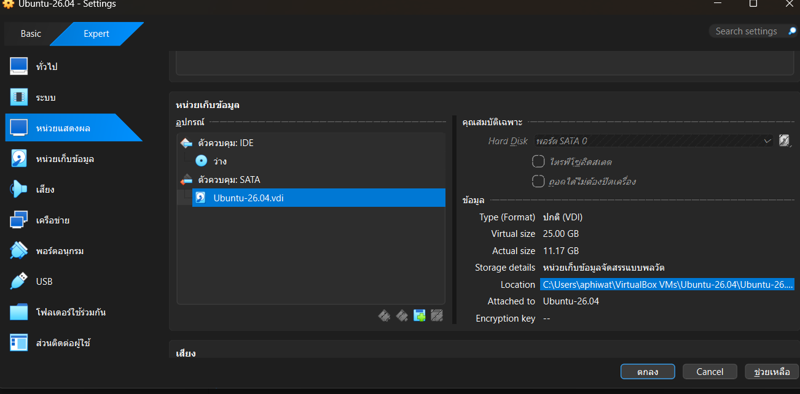

*ภาพ: การตั้งค่า VM ใน VirtualBox แสดง 2 vCPU*

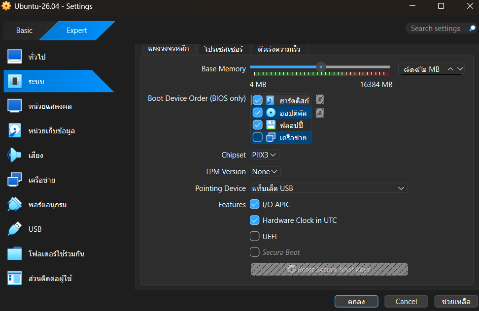

*ภาพ: System specifications ของ VM*

---

### 2. ผลการทดสอบเปรียบเทียบกับ ftrace และความทนทานของระบบ

### 7.1 การ Build Module

Module สามารถ build ได้สำเร็จด้วย `make` โดย kbuild จะ compile ไฟล์ `.c` ทั้ง 5 แล้วรวมเป็น `sched_profiler.ko`

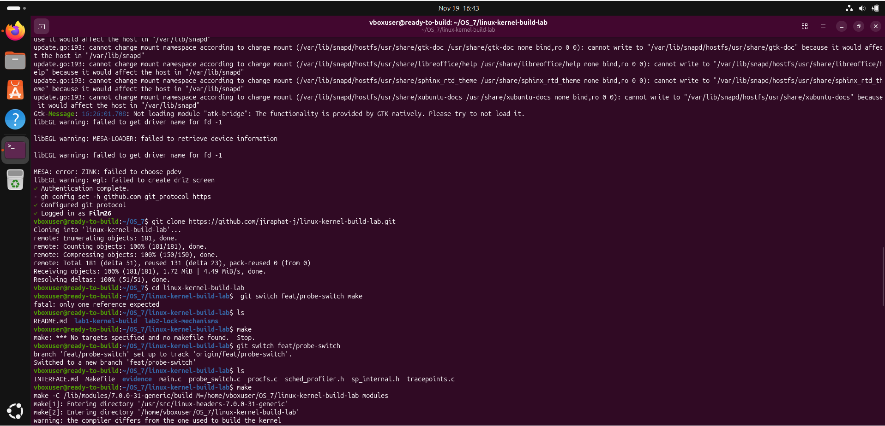

*ภาพ: ผลการ build module สำเร็จ*

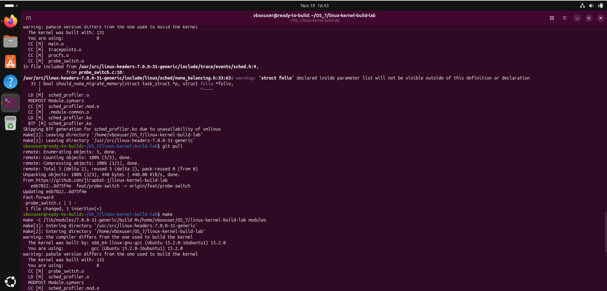

*ภาพ: แก้ warning `struct folio` โดยเพิ่ม `#include <linux/mm_types.h>`*

### 7.2 ผลเทียบตัวนับ — Module vs ftrace

ทดสอบด้วย workload 3 แบบ โดยเปรียบเทียบค่าจาก module กับ ftrace ในช่วงเวลาเดียวกันและ TID เดียวกัน:

| Workload | TID | ตัวนับ | Module | ftrace | ผล |
|---|---:|---|---:|---:|:---:|
| **CPU-bound** | 4609 | switch_in | 152 | 152 | ✅ |
| | | switch_out | 152 | 152 | ✅ |
| | | wakeups | 1 | 1 | ✅ |
| | | migrations | 2 | 2 | ✅ |
| **Sleep-heavy** | 4612 | switch_in | 47 | 47 | ✅ |
| | | switch_out | 47 | 47 | ✅ |
| | | wakeups | 44 | 44 | ✅ |
| | | migrations | 0 | 0 | ✅ |
| **สลับ CPU affinity** | 4613 | switch_in | 61 | 61 | ✅ |
| | | switch_out | 61 | 61 | ✅ |
| | | wakeups | 55 | 55 | ✅ |
| | | migrations | 7 | 7 | ✅ |

> [!TIP]
> ผลลัพธ์จาก module ตรงกับ ftrace **ทุกตัวนับ ทุก workload** (12/12 ตัวนับตรง 100%)

**คำอธิบาย Workload:**

1. **CPU-bound** — โปรแกรมที่คำนวณหนัก (Python loop) พร้อม task อื่นแย่ง CPU → เกิด context switch บ่อย แต่แทบไม่มี wakeup
2. **Sleep-heavy** — โปรแกรมที่ sleep ทุก 0.1 วินาที → เกิด wakeup บ่อย (44 ครั้ง) เท่ากับจำนวน sleep
3. **สลับ CPU affinity** — ใช้ `taskset -pc` สลับ CPU 0↔1 จำนวน 6 ครั้ง → migrations = 7 (รวมการตรึง CPU ครั้งแรก 1 ครั้ง)

**หลักฐานผลทดสอบ:**

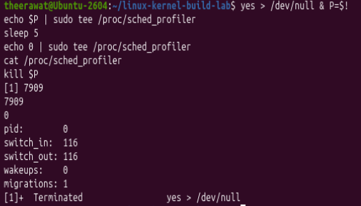

*ภาพ: ผลทดสอบ CPU-bound workload*

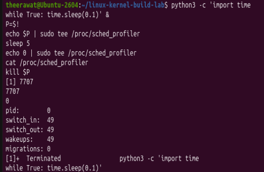

*ภาพ: ผลทดสอบ Sleep-heavy workload*

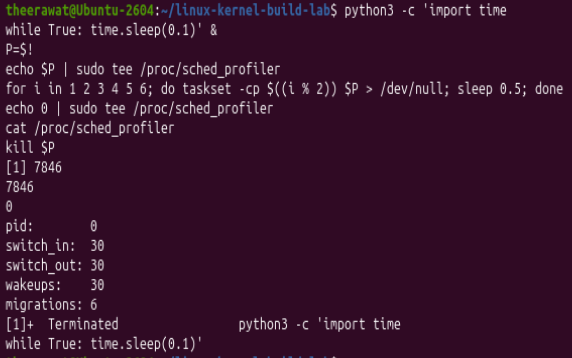

*ภาพ: ผลทดสอบ Migration workload*

### 7.3 ตรวจประกอบจาก /proc

ตรวจยืนยันเพิ่มเติมจาก `/proc/<tid>/status` และ `/proc/<tid>/sched`:

| Workload | ที่มา | Switch (delta) | Migration (delta) | ตรงกับ Module |
|---|---|---:|---:|:---:|
| CPU-bound | `nr_switches` (after-before) | 152 | 2 | ✅ |
| Sleep-heavy | `nr_switches` | 47 | 0 | ✅ |
| Migration | `nr_switches` | 61 | 7 | ✅ |

### 7.4 การทดสอบ Robustness

ทดสอบความทนทานรวม 11 กรณี — **ผ่านทั้งหมด:**

| # | กรณีทดสอบ | ผลที่คาดหวัง | ผลจริง |
|---|---|---|:---:|
| 1 | อ่านก่อน start | error: -61 (ENODATA) | ✅ |
| 2 | เขียน `abc` | EINVAL | ✅ |
| 3 | เขียน `-5` | EINVAL | ✅ |
| 4 | เขียน `99999999` | ESRCH | ✅ |
| 5 | Start ซ้อน | EBUSY | ✅ |
| 6 | Stop แล้วอ่าน | ตัวนับคงค่า | ✅ |
| 7 | Start ใหม่ | ตัวนับ reset | ✅ |
| 8 | เฝ้า sleep ขณะ CPU เต็ม | 0/0 (ไม่มี false positive) | ✅ |
| 9 | rmmod ขณะกำลังวัด | ถอดได้ ไม่ oops | ✅ |
| 10 | insmod/rmmod 10 รอบ | ไม่มี error | ✅ |
| 11 | dmesg ไม่มี oops/BUG/WARNING | สะอาด | ✅ |

**หลักฐาน Robustness Test:**

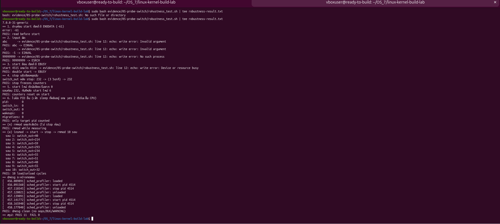

*ภาพ: ผลทดสอบ robustness — PASS 11, FAIL 0*

### 7.5 การทดสอบ Edge Cases ของ procfs

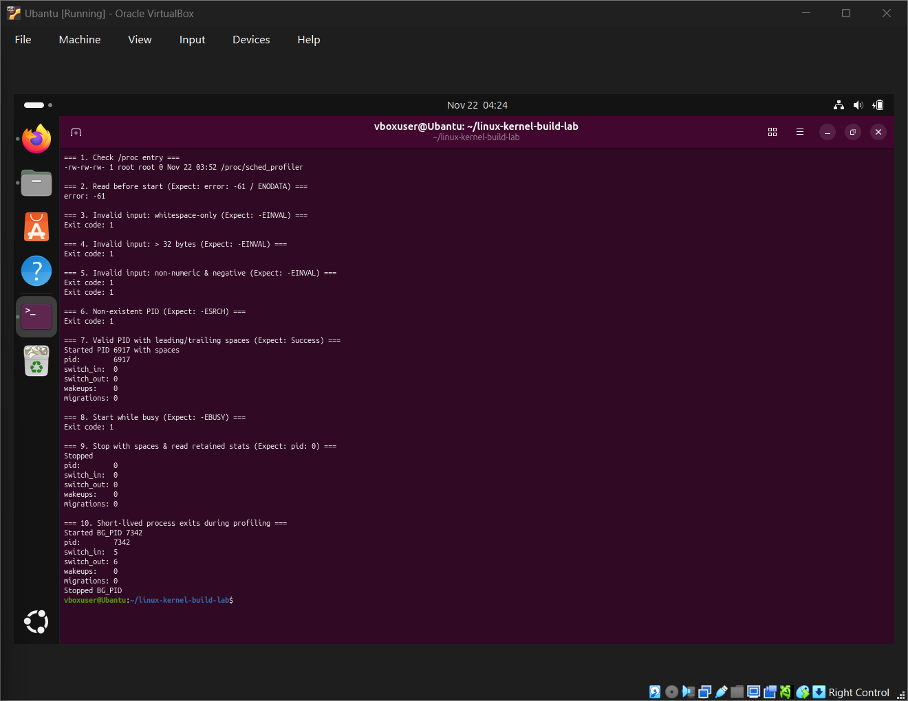

*ภาพ: ผลทดสอบ edge cases ของ /proc/sched_profiler*

ทดสอบรวมถึง:
- Input ที่มีช่องว่าง ` 1234 ` → ใช้งานได้ (strim ตัด whitespace)
- Input ที่ยาวเกิน 32 bytes → คืน EINVAL
- PID ที่ process จบระหว่างวัด → ตัวนับยังอ่านได้
- Stop แล้วตัวนับคงค่าเดิม, PID เป็น 0

---

### 3. การทดสอบขั้นสูงร่วมกับ perf และความปลอดภัยในการทำงานพร้อมกัน

### 8.1 เปรียบเทียบกับ `perf stat`

| ตัวนับ | Module | perf stat | ตรง |
|---|---:|---:|:---:|
| context-switches (switch_out) | 62 | 62 | ✅ |
| cpu-migrations | 6 | 6 | ✅ |

### 8.2 ทดสอบ `rmmod` ขณะกำลังวัด

| ขั้นตอน | ผล |
|---|---|
| เริ่มวัด TID 4309 | switch_in=5, wakeups=4 |
| `rmmod sched_profiler` ขณะวัด | ถอดสำเร็จ |
| `/proc/sched_profiler` | หายไปหลังถอด |
| target TID 4309 | ยังทำงานปกติ |
| kernel log | ไม่มี fault/warning |

### 8.3 ทดสอบ Concurrent Start (Race Condition)

ส่ง `sp_start()` พร้อมกันจาก 2 ตัวเขียน — **ผ่าน 25/25 รอบ:**
- ทุกรอบมีเพียง 1 คำสั่งที่สำเร็จ อีกคำสั่งได้ `EBUSY`
- PID ที่แสดงตรงกับคำสั่งที่สำเร็จ
- mutex ทำงานถูกต้อง ไม่มี data race

### 8.4 `perf sched timehist`

ทดสอบ TID 1899 พบ 73 แถวใน timeline — ยืนยันว่า profiler สามารถจับ event ได้สอดคล้องกับ `perf sched`

**หลักฐาน Terminal:**

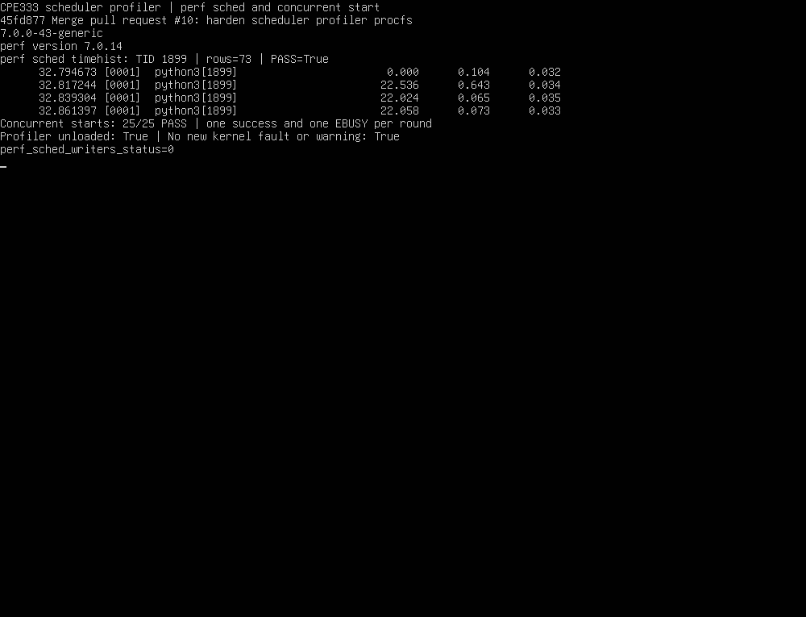

*ภาพ: คอนโซล VM ขณะรันการทดสอบจริง*

---

## **สรุปผลการทดลอง อภิปรายผล และบทเรียนที่ได้รับ (Conclusion, Discussion & Retrospective)**

### 1. สรุปผลงานตามเป้าหมาย

### 9.1 สรุปผลงาน

Process Scheduler Profiler สำเร็จตามเป้าหมายที่กำหนด:

| ความต้องการ | สถานะ |
|---|:---:|
| รับ PID ผ่าน /proc | ✅ |
| นับจำนวนครั้ง schedule in/out | ✅ |
| นับจำนวนครั้ง wakeup | ✅ |
| นับจำนวนครั้ง CPU migration | ✅ |
| ตัวเลขตรงกับ ftrace | ✅ 100% (12/12) |
| ตรงกับ perf stat | ✅ |
| ป้องกัน kernel panic | ✅ (tracepoint_synchronize_unregister) |
| ทดสอบ robustness | ✅ PASS 11/11 |
| Concurrent safety | ✅ PASS 25/25 |

### 9.2 บทเรียนที่ได้

1. **Tracepoint ของ scheduler ไม่ถูก export ให้ module** — ต้องใช้ `for_each_kernel_tracepoint()` ค้นหาตามชื่อ แล้ว `tracepoint_probe_register()` เอง ซึ่งเป็นข้อจำกัดสำคัญของการเขียน kernel module

2. **`tracepoint_synchronize_unregister()` จำเป็นอย่างยิ่ง** — ถ้าไม่เรียกก่อน rmmod จะเกิด use-after-free บน CPU อื่นที่ยังรัน probe → kernel panic

3. **ใช้ `atomic_long_t` สำหรับตัวนับ** — เนื่องจาก probe อาจถูกเรียกบนหลาย CPU พร้อมกัน การใช้ตัวนับธรรมดา (`unsigned long++`) จะ race

4. **`MODULE_LICENSE("GPL")` ไม่ใช่แค่ formalitiy** — ถ้าไม่ใส่จะเรียก GPL-only symbol ไม่ได้ เช่น `for_each_kernel_tracepoint`

5. **ตรวจ signature ตอน compile** — เทคนิค `sizeof(register_trace_X(func, NULL))` ช่วยจับ signature mismatch ก่อนรัน

6. **Mutex กัน race ระหว่าง start/stop** — ป้องกันปัญหาเมื่อ 2 shell เขียน /proc พร้อมกัน

7. **การตั้งค่า interface ก่อนเขียนโค้ดสำคัญมาก** — INTERFACE.md ทำให้ 5 คนพัฒนาแยกกันแล้วรวมได้ในครั้งเดียว

### 9.3 ข้อจำกัด

- นับตาม **Thread ID (TID)** ไม่ใช่ Process Group — ถ้าโปรแกรมมีหลาย thread ต้องวัดทีละ thread
- วัดได้ทีละ 1 PID — ต้อง stop ก่อน start PID ใหม่
- ค่าที่ได้จาก `/proc/<pid>/status` อาจไม่ตรงเป๊ะเพราะช่วงเวลาวัดต่างกัน (ใช้ ftrace เป็น reference ที่แม่นยำกว่า)

---

## **ภาคผนวก (Appendix)**

### A. วิธี Build และทดสอบ

```bash
# 1. ติดตั้ง dependencies
sudo apt install build-essential pahole linux-headers-$(uname -r)

# 2. Clone และ build
git clone -b mini2 https://github.com/jiraphat-j/linux-kernel-build-lab.git
cd linux-kernel-build-lab
make

# 3. ตรวจ vermagic
modinfo -F vermagic ./sched_profiler.ko

# 4. โหลด module
sudo insmod sched_profiler.ko

# 5. ตรวจว่าโหลดสำเร็จ
dmesg | tail
ls -la /proc/sched_profiler

# 6. ใช้งาน
# เริ่มวัด
echo 1234 > /proc/sched_profiler
# อ่านผล
cat /proc/sched_profiler
# หยุดวัด
echo 0 > /proc/sched_profiler

# 7. ถอด module
sudo rmmod sched_profiler
```

### B. Script ทดสอบ

```bash
#!/bin/bash
# ทดสอบ sched_switch counting
yes > /dev/null & PID=$!
sleep 1
b=$(awk '/ctxt/{s+=$2} END{print s}' /proc/$PID/status)
echo $PID > /proc/sched_profiler
sleep 5
echo 0 > /proc/sched_profiler
a=$(awk '/ctxt/{s+=$2} END{print s}' /proc/$PID/status)
kill $PID
echo "PID=$PID   /proc delta = $((a-b))"
cat /proc/sched_profiler
```

### C. ตัวอย่าง Output จริง

```
pid:        4609
switch_in:  152
switch_out: 152
wakeups:    1
migrations: 2
```

### D. GitHub Repository

- Branch: `mini2`
- URL: https://github.com/jiraphat-j/linux-kernel-build-lab/tree/mini2
- Commit ที่ทดสอบ: `45fd877a5da9a62859f9e82d62ba810b1654cbfb`


[image1]: <>
